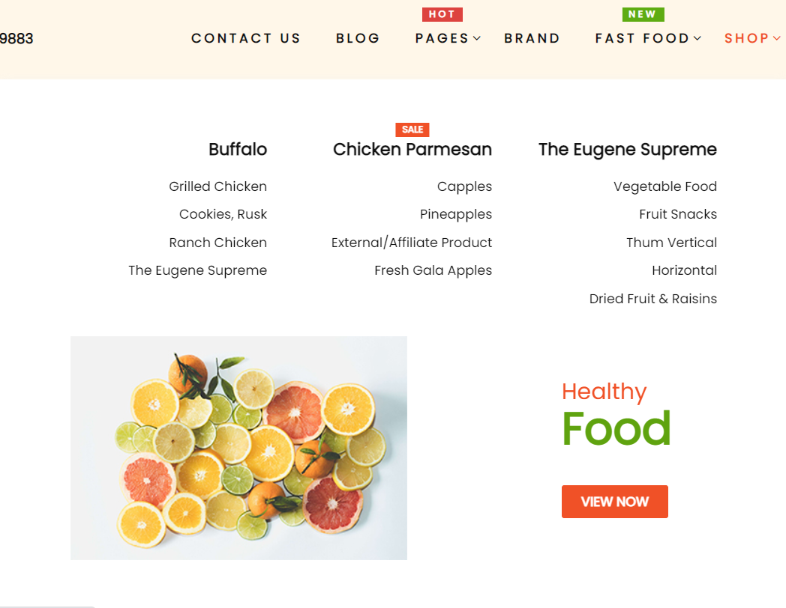
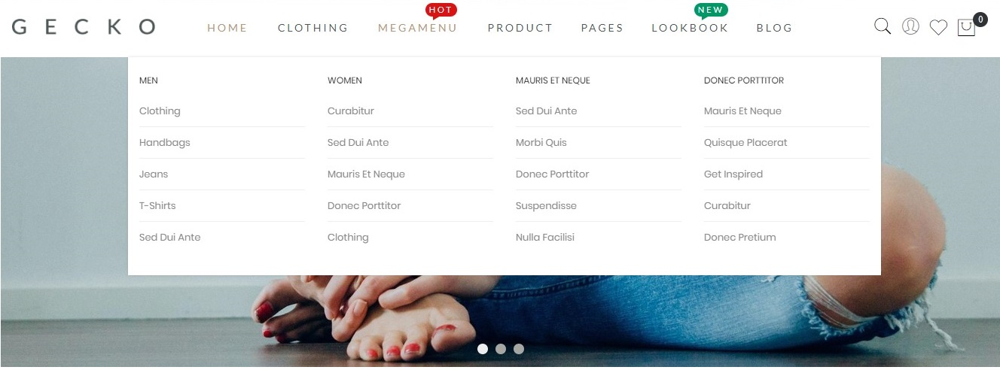
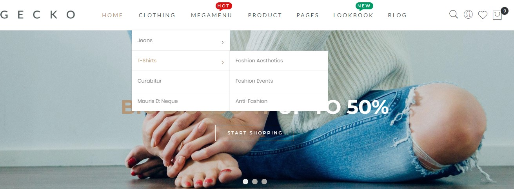
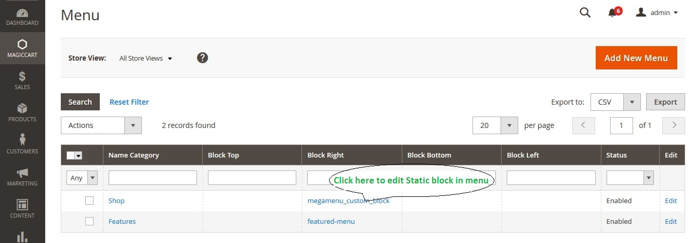

<div align="center">
  <div>
    <a href="https://magepow.com/magento-2-mega-menu.html">
      
    </a>
  </div>
  <a href="https://packagist.org/packages/magiccart/magicmenu">
    
  </a>
  <a href="https://packagist.org/packages/magiccart/magicmenu">
    
  </a>
  <a href="https://packagist.org/packages/magiccart/magicmenu">
    
  </a>
</div>

<h1 align="center">Magento 2 Mega Menu</h1>

Welcome to Magepow Magento 2 Mega Menu! Our free module helps you create a user-friendly navigation experience and improve the usability of your online store.

For merchants who need professional assistance and reliable ongoing support, we recommend purchasing the module from Magepow. Our support service helps you get the most out of the module, resolve technical issues, and ensure a smoother experience when integrating it into your Magento store.


**Magento 2 Mega menu extension** is an indispensable component, and plays the role of website navigation to help customers easily categorize and find information. Without a menu, visitors to the page will have to spend time searching for each content on your website, thereby making them find it difficult, difficult to access and do not know what your website has main content. This will increase the user's bounce rate, thereby reducing the SEO quality of the website.



Mega menu, dropdown menu and mobile menu for Magento 2 / Adobe Commerce.

The module replaces the default `store.menu` block with a configurable navigation that supports
mega menu layouts, plain dropdown menus, an extra (custom) menu and a sidebar accordion menu.

## Get started

- [Quick start install](https://docs.magepow.com/magicmenu)
- [Requirements Magento Open Source / Adobe Commerce](https://experienceleague.adobe.com/docs/commerce-operations/installation-guide/system-requirements.html)
- [👉 Magento 2 Mega Menu Pro](https://magepow.com/magento-2-mega-menu.html)

## Installation

```bash
composer require magiccart/magicmenu
bin/magento setup:upgrade
bin/magento setup:static-content:deploy -f
bin/magento cache:flush
```

Manual installation: copy the module to `app/code/Magiccart/Magicmenu` and run the commands above
without the `composer require` line.

## Need Professional Support?

Magepow Magento 2 Mega Menu is free and open-source, allowing you to build intuitive and user-friendly navigation for your Magento store.

If you need professional technical assistance, help with configuration, troubleshooting, or ongoing support, you can purchase the module with our support service directly from the Magepow website.

Get professional support and make the most of your Magento 2 Mega Menu.

[👉 Purchase Mega Menu Pro with Support](https://magepow.com/magento-2-mega-menu.html)

## Highlight features

### 1. Mega menu, dropdown menu or both

**Mega menu**

The mega menu saves horizontal space and gives every top category its own panel made of CMS
static blocks placed on the top, left, right and bottom of the category list.



**Dropdown menu**

A dropdown menu shows the sub categories on hover or on click. It fits catalogs with many
categories and keeps the navigation compact.



### 2. Extra menu

`Magiccart > Magic Menu > Extra Menu` adds standalone entries to the navigation. Each entry shows a
link, a CMS static block, or both.



### 3. Responsive and mobile menu

The menu adapts to the screen: the desktop navigation is replaced by a mobile menu below the
breakpoint defined in the configuration. The sticky option keeps the menu visible while scrolling.

### 4. Category label, image and thumbnail

Each category can show a label, a thumbnail and an image inside the mega menu. The values are set
in `Catalog > Manage Categories` and are stored as the `magic_label`, `magic_thumbnail` and
`magic_image` category attributes.

## Configuration

`Stores > Configuration > Magiccart > Magic Menu`

| Group | Description |
|---|---|
| General | Categories that are rendered as a simple dropdown instead of a mega menu. |
| Top Menu | Horizontal menu: enable/disable, home button, multi store demo switcher, sticky menu, screen breakpoint, event (hover/click), full width mode, excluded categories. |
| Vertical Menu | Same options as the top menu for the vertical navigation. |
| Accordion | Enable the accordion menu rendered in the sidebar on category pages. |

### Category configuration

`Catalog > Categories > <category>`

* `Label` – comma separated list of labels rendered next to the category name.
* `Thumbnail` / `Image` – uploaded to `pub/media/magiccart/magicmenu/thumbnail/<id>.png` and
  `pub/media/magiccart/magicmenu/images/<id>.png`.

### Mega menu / extra menu configuration

`Magiccart > Magic Menu > Menu` binds a top category to a layout made of CMS static blocks
(top, left, right, bottom) with configurable proportions.

`Magiccart > Magic Menu > Extra Menu` adds a standalone entry to the navigation. It renders either
a link or a CMS static block.

The values stored in the `top`, `left`, `right`, `bottom` and `ext_content` fields are **CMS block
identifiers**, not block IDs.

#### Proportions of the mega menu

The width of the mega menu is shared between the category list, the left block and the right block.
The three proportion fields are weights: the total of the weights is used to calculate the width of
every part.

| Proportion | Meaning |
|---|---|
| Proportion: Category | Weight of the category list. |
| Proportion: Block Left | Weight of the block displayed on the left. |
| Proportion: Block Right | Weight of the block displayed on the right. |

Example: `Proportion: Category = 2`, `Proportion: Block Left = 1` and `Proportion: Block Right = 0`
give 67% of the width to the categories and 33% to the left block.

## Extension points

| Type | Name |
|---|---|
| Service contract | `Magiccart\Magicmenu\Api\MagicmenuRepositoryInterface` |
| Data contract | `Magiccart\Magicmenu\Api\Data\MagicmenuInterface` |
| Search results | `Magiccart\Magicmenu\Api\Data\MagicmenuSearchResultsInterface` |
| Frontend block | `Magiccart\Magicmenu\Block\Menu` |
| Configuration reader | `Magiccart\Magicmenu\Model\Config` |
| Visibility options | `Magiccart\Magicmenu\Model\System\Config\Visibility` |

Use the repository instead of loading or saving the model directly:

```php
$menu = $this->magicmenuRepository->getById($id);
$menu->setName('New name');
$this->magicmenuRepository->save($menu);
```

## Upgrade notes (2.1.0)

The release is backward compatible: existing installations keep working and a custom theme does
**not** have to be updated.

* A new `visibility` column is added to the `magiccart_magicmenu` table by the declarative schema.
  Run `bin/magento setup:upgrade` to apply it. Existing rows get the default value `0`
  (show on desktop and mobile), so the menu renders exactly as before.
* No `setup_version` / `InstallSchema` / `UpgradeSchema` script is used, the column is declared in
  `etc/db_schema.xml` only.
* `Block\Menu::drawExtraMenu()` keeps its signature and its behaviour: it renders **every** extra
  menu item, whatever its visibility is. A theme that still uses the original templates therefore
  shows the complete extra menu on the desktop and on the mobile, exactly like the previous
  versions. The visibility setting is simply ignored there. A legacy call that passes a visibility
  (`drawExtraMenu('mobile')`) is still honoured.
* `Block\Menu::getExtraMenu()` keeps its signature and returns the complete extra menu
  collection of the current store, it is not filtered by a visibility anymore.

  ```php
  use Magiccart\Magicmenu\Model\System\Config\Visibility;

  // desktop navigation
  $drawExtraMenu = $block->drawExtraMenuByVisibility(Visibility::DESKTOP_ONLY);
  // mobile navigation
  $drawExtraMobileMenu = $block->drawExtraMenuByVisibility(Visibility::MOBILE_ONLY);
  ```

  A theme that copies the templates only has to replace the `drawExtraMenu()` call with the two
  calls above, everything else stays the same.
* `Magiccart\Magicmenu\Api\Data\MagicmenuInterface` gained the `KEY_VISIBILITY` constant and
  the `getVisibility()` / `setVisibility()` accessors. A third party implementation of the
  interface has to add the two methods.

### Visibility of an extra menu

`Magiccart > Magic Menu > Extra Menu > Edit > Visibility Location` selects where an extra menu
item is rendered.

| Value | Meaning |
|---|---|
| Show On Desktop / Mobile | The item is rendered in the desktop and in the mobile menu. |
| Desktop Only | The item is only rendered in the desktop navigation. |
| Mobile Only | The item is only rendered in the mobile navigation. |

The setting only has an effect on a theme that renders the desktop and the mobile menu
separately, see the upgrade notes above.

## Upgrade notes (2.0.0)

* The module moved from `setup_version` / `InstallSchema` / `InstallData` to declarative schema
  (`etc/db_schema.xml`) and a data patch (`Setup/Patch/Data/AddCategoryMagicAttributes.php`).
  The patch is idempotent: existing category attributes are not recreated.
* The CMS static blocks are now resolved by identifier (`Magento\Cms\Block\BlockByIdentifier`)
  instead of the deprecated `Magento\Cms\Block\Block`.
* `Magiccart\Magicmenu\Helper\Data` is deprecated, use `Magiccart\Magicmenu\Model\Config` instead.
* The `Registry` based transfer of the edited entity between controller and form block was removed.
* The `exclude_html_desktop` and `exclude_html_mobile` settings were removed, the attributes they
  rendered were never read by the JavaScript.

## Development

```bash
vendor/bin/phpcs --standard=Magento2 --severity=10 app/code/Magiccart/Magicmenu
vendor/bin/phpcs --standard=Magento2 --extensions=php,phtml app/code/Magiccart/Magicmenu
vendor/bin/phpunit -c dev/tests/unit/phpunit.xml.dist app/code/Magiccart/Magicmenu/Test/Unit
```

## License

OSL-3.0 / AFL-3.0. See [LICENSE](LICENSE).

## Donation

If this project help you reduce time to develop, you can give me a cup of coffee :) 

[](https://www.paypal.com/paypalme/dongvannguyen)

**[Our Magento 2 Extensions](https://magepow.com/magento-2-extensions.html)**

* [Magento 2 Recent Sales Notification](https://magepow.com/magento-2-recent-order-notification.html)

* [Magento 2 Categories Extension](https://magepow.com/magento-categories-extension.html)

* [Magento 2 Sticky Cart](https://magepow.com/magento-sticky-cart.html)

* [Magento 2 Ajax Contact](https://magepow.com/magento-ajax-contact-form.html)

* [Magento 2 Lazy Load](https://magepow.com/magento-lazy-load.html)

* [Magento 2 Mutil Translate](https://magepow.com/magento-multi-translate.html)

* [Magento 2 Instagram Integration](https://magepow.com/magento-2-instagram.html)

* [Magento 2 Lookbook Pin Products](https://magepow.com/lookbook-pin-products.html)

* [Magento 2 Product Slider](https://magepow.com/magento-product-slider.html)

* [Magento 2 Product Banner](https://magepow.com/magento-2-banner-slider.html)

**[Our Magento 2 services](https://magepow.com/magento-services.html)**

* [PSD to Magento 2 Theme Conversion](https://alothemes.com/psd-to-magento-theme-conversion.html)

* [Magento 2 Speed Optimization Service](https://magepow.com/magento-speed-optimization-service.html)

* [Magento 2 Security Patch Installation](https://magepow.com/magento-security-patch-installation.html)

* [Magento 2 Website Maintenance Service](https://magepow.com/website-maintenance-service.html)

* [Magento 2 Professional Installation Service](https://magepow.com/professional-installation-service.html)

* [Magento 2 Upgrade Service](https://magepow.com/magento-upgrade-service.html)

* [Magento 2 Customization Service](https://magepow.com/customization-service.html)

* [Hire Magento 2 Developer](https://magepow.com/hire-magento-developer.html)

**[Our Magento 2 Themes](https://alothemes.com/)**

* [Expert Multipurpose Responsive Magento 2 Theme](https://1.envato.market/c/1314680/275988/4415?u=https://themeforest.net/item/expert-premium-responsive-magento-2-and-1-support-rtl-magento-2-/21667789)

* [Gecko Premium Responsive Magento 2 Theme](https://1.envato.market/c/1314680/275988/4415?u=https://themeforest.net/item/gecko-responsive-magento-2-theme-rtl-supported/24677410)

* [Milano Fashion Responsive Magento 2 Theme](https://1.envato.market/c/1314680/275988/4415?u=https://themeforest.net/item/milano-fashion-responsive-magento-1-2-theme/12141971)

* [Electro 2 Responsive Magento 2 Theme](https://1.envato.market/c/1314680/275988/4415?u=https://themeforest.net/item/electro2-premium-responsive-magento-2-rtl-supported/26875864)

* [Electro Responsive Magento 2 Theme](https://1.envato.market/c/1314680/275988/4415?u=https://themeforest.net/item/electro-responsive-magento-1-2-theme/17042067)

* [Pizzaro Food responsive Magento 2 Theme](https://1.envato.market/c/1314680/275988/4415?u=https://themeforest.net/item/pizzaro-food-responsive-magento-1-2-theme/19438157)

* [Biolife organic responsive Magento 2 Theme](https://1.envato.market/c/1314680/275988/4415?u=https://themeforest.net/item/biolife-organic-food-magento-2-theme-rtl-supported/25712510)

* [Market responsive Magento 2 Theme](https://1.envato.market/c/1314680/275988/4415?u=https://themeforest.net/item/market-responsive-magento-2-theme/22997928)

* [Kuteshop responsive Magento 2 Theme](https://1.envato.market/c/1314680/275988/4415?u=https://themeforest.net/item/kuteshop-multipurpose-responsive-magento-1-2-theme/12985435)

* [Bencher - Responsive Magento 2 Theme](https://1.envato.market/c/1314680/275988/4415?u=https://themeforest.net/item/bencher-responsive-magento-1-2-theme/15787772)

* [Supermarket Responsive Magento 2 Theme](https://1.envato.market/c/1314680/275988/4415?u=https://themeforest.net/item/supermarket-responsive-magento-1-2-theme/18447995)

**[Our Shopify App](https://apps.shopify.com/partners/maggicart)**

* [Magepow Infinite Scroll](https://apps.shopify.com/magepow-infinite-scroll)

* [Magepow Product Zoom](https://apps.shopify.com/magepow-productzoom)

* [Magepow Size Chart](https://apps.shopify.com/magepow-size-chart)

**[Our Shopify Themes](https://themeforest.net/user/alotheme)**

* [Uminex - Fastest Shopify 2.0 Theme](https://themeforest.net/item/uminex-fastest-shopify-20-theme/46350215)
* [Dukamarket - Multipurpose Shopify Theme](https://1.envato.market/c/1314680/275988/4415?u=https://themeforest.net/item/dukamarket-multipurpose-shopify-theme/36158349)

**[Our WordPress Theme](https://themeforest.net/user/alotheme/portfolio)**

* [KuteShop - Marketplace Elementor WooCommerce Theme](https://1.envato.market/c/1314680/275988/4415?u=https://themeforest.net/item/kuteshop-multipurpose-woocommerce-wordpress-theme/13012521)
